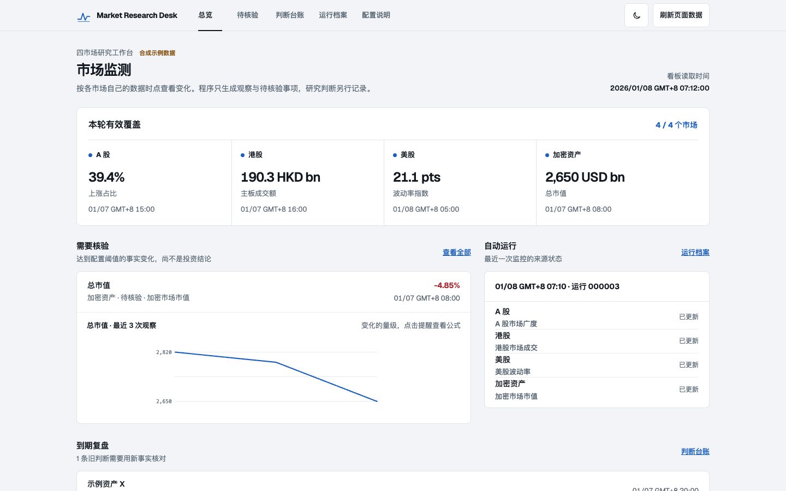
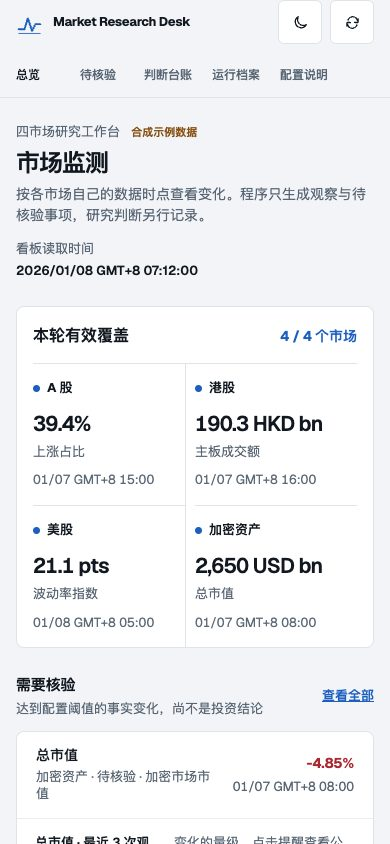
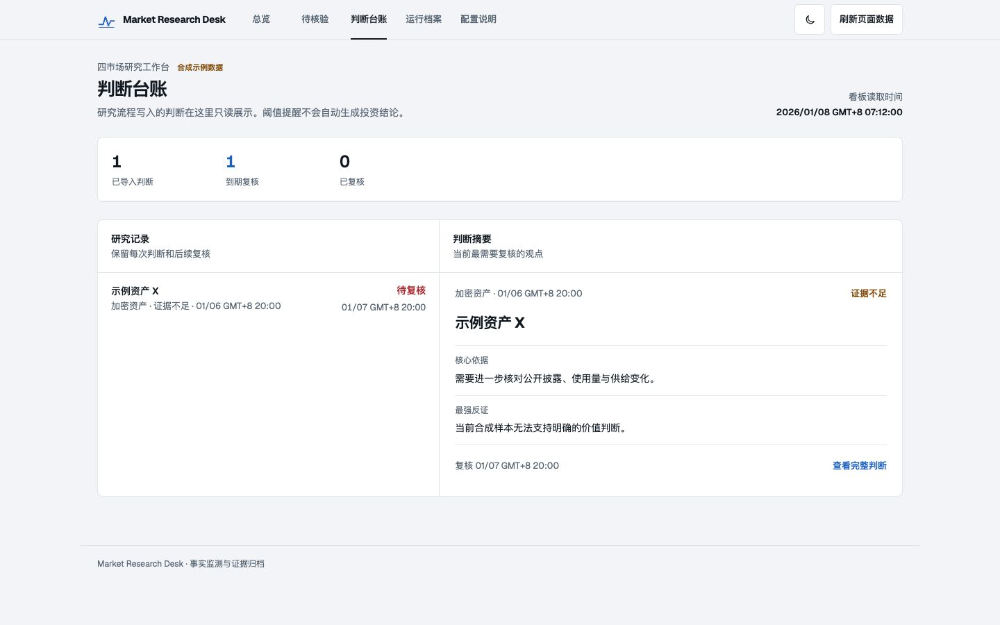
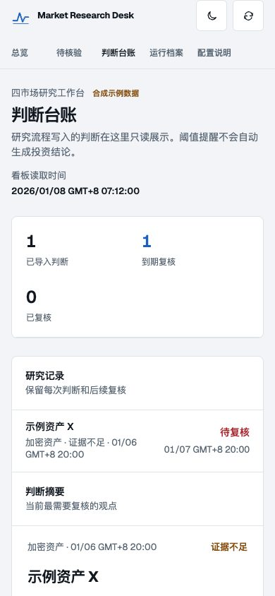

# Market Research Desk

An open-source, self-hosted research monitor for A shares, Hong Kong stocks, US stocks, and crypto. It gathers configured facts, compares compatible observations, archives each run, and shows a read-only evidence dashboard. Threshold alerts are **questions for research**, never buy or sell signals.

The repository contains program code and an explicitly labelled synthetic preview. It contains no personal portfolio, private research reports, actual market archive, API credentials, Telegram recipients, or server addresses.

## Interface preview

These screenshots use fictional, explicitly labelled sample data. The default installation starts empty.

| Desktop | Phone |
| --- | --- |
|  |  |
|  |  |

## Quick start

Requires Node.js 22 or newer. No npm dependencies are needed.

```bash
cp .env.example .env
node scripts/generate-sample.mjs
npm start
```

Open `http://127.0.0.1:4173`. A fresh installation honestly shows four unconnected markets. Open `http://127.0.0.1:4173/?sample=1` for the synthetic visual preview; its values are fictional and dated January 2026.

If you set `DATA_DIR` in `.env`, start the web server with `node --env-file=.env src/server.js` so it reads the same archive directory as the monitor.

To run the monitor with environment variables from a local file:

```bash
node --env-file=.env src/cli.js run
```

Set `CONFIG_PATH=./config/local.json` in `.env` after copying `config/example.json`. `config/local.json` and all `data/` run files are ignored by Git.

## Configure monitors

Each source belongs to one market and is either `http-json` or `command`. A source maps response fields to metrics. Only finite numeric values become observations. An optional threshold creates a factual alert when a new observation crosses it against the previous valid observation of the same source, metric and unit.

```json
{
  "version": 1,
  "sources": [{
    "id": "my-market-source",
    "market": "us",
    "kind": "http-json",
    "urlEnv": "US_MARKET_API_URL",
    "maxAgeMinutes": 4320,
    "headers": { "Authorization": "Bearer ${MARKET_API_TOKEN}" },
    "publicUrl": "https://provider.example/methodology",
    "metrics": [{
      "id": "breadth",
      "label": "Advancing share",
      "path": "data.advancing_share",
      "asOfPath": "data.as_of",
      "unit": "%",
      "alertAbsolute": 5
    }]
  }]
}
```

Use `alertPercent` for relative change or `alertAbsolute` for a change in the metric's own unit. For a `%` metric, `alertAbsolute: 5` means five percentage points. The source's `asOfPath` must be a parseable ISO time or Unix seconds. If omitted, the fetch time is used and the metric should be described as an observation at fetch time, not a market close. `maxAgeMinutes` is required for sources with metrics. Older observations are archived as stale, hidden from the current-value view, and cannot trigger alerts. Set the limit for each source's publication cadence and market holidays.

The example config intentionally leaves A shares, Hong Kong, and US metrics empty. Add fields only after checking the provider's actual schema, coverage, time zone, and terms for storing or displaying data. The sample crypto mapping is illustrative and may need adjustment to a chosen provider. There is no claim of built-in full-market coverage.

For a local script, place a `.mjs` file in `scripts/monitors/` and configure `kind: "command"` with its filename in `command`. It must print one JSON object to stdout; `metrics[].path` reads fields from that object. Scripts are trusted operator code, read only from configuration at process start. The web server never executes them. Use environment variables for script credentials and avoid printing credentials to stdout or stderr.

## Archive and notifications

Each run is written to `DATA_DIR/runs/<run-id>/run.json` through an atomic rename. A failed or missing source is recorded, and a stale value never becomes a new alert. The archive records each metric's field mapping, unit and threshold so an old alert remains explainable after configuration changes. It keeps only configured observations and source metadata, not raw third-party payloads or full-market intraday prices. It never stores a URL's query string or HTTP authorization header. Notification delivery results are separate files in `DATA_DIR/`; a failed notification does not change the immutable observation run.

Set `TELEGRAM_BOT_TOKEN` and `TELEGRAM_CHAT_ID` for Telegram, or `ALERT_WEBHOOK_URL` and optional `ALERT_WEBHOOK_BEARER` for an outbound webhook. Alerts contain only a count, alert IDs, run ID, optional dashboard URL, and a reminder that no investment conclusion was generated. Bot tokens and recipients stay in the private environment, never in Git, logs, or alert bodies. Notifications are only sent for newly generated alerts.

If delivery fails, run `node src/cli.js retry` to retry channels without a recorded successful send. Telegram cannot guarantee exactly-once delivery if a process crashes after sending but before recording success; the alert ID helps recognize a duplicate.

## Read-only research decisions

A private research process can export one JSON object per line to `DATA_DIR/decisions.jsonl`. The dashboard reads it but never writes judgments. Keep this file outside the Git repository or inside the ignored `data/` directory. An example record shape:

```json
{"id":"research-001","market":"crypto","asset":"Example Asset","verdict":"insufficient evidence","asOf":"2026-01-07T12:00:00Z","price":null,"currency":"USD","horizon":"30 days","thesis":"Evidence to check","counterEvidence":"Strongest contrary observation","invalidatedBy":"Condition that would reverse this view","reviewAt":"2026-02-07T12:00:00Z","evidenceRunIds":["run-id-from-archive"]}
```

`market` is one of `a-share`, `hong-kong`, `us`, or `crypto`. `reviewAt` marks an item as due once that time passes; `verifiedAt` marks a completed review. Preserve revisions as separate records with new IDs rather than overwriting an old judgment. This format is an import contract, not an alternative write path for an existing private research ledger.

The web API returns only the documented decision fields; extra fields in a private export are discarded. Any text placed in `thesis`, `counterEvidence`, or similar displayed fields is still visible to authenticated dashboard viewers, so keep account details and credentials out of them.

Schedule `npm run monitor` with a host scheduler. [`docs/deploy/systemd.md`](docs/deploy/systemd.md) gives a Linux example. The dashboard starts with `npm start` and reads archives; it does not schedule monitoring itself.

## Private deployment

By default the dashboard listens on `127.0.0.1:4173`. To access it remotely, put an authentication layer in front of a Tunnel or reverse proxy. For Cloudflare, create a private Access application and a Tunnel route to the loopback service; verify that an unauthenticated browser cannot load the page or `/api/state` before adding real research data. `ALLOW_REMOTE=1` is required to bind a non-loopback address and should only be used behind an authenticated proxy.

Keep personal holdings, deep research, reports, database indexes, and decisions in a private storage location. If a private research process exports decisions, link each one to a run ID and its evidence. The public repository contains no real judgments, and the monitor does not infer them. Check each data provider's license before retaining or redistributing observations.

## Development

```bash
npm run check
node --check public/app.js
```

The design and interaction contract is in [`docs/architecture/market-research-desk-design-md.md`](docs/architecture/market-research-desk-design-md.md).

## License

MIT. See [`LICENSE`](LICENSE).
