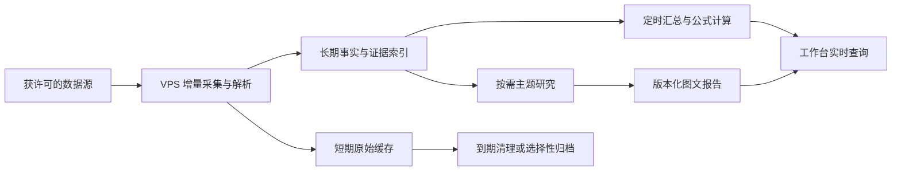

# 决策研究台：使用目标、历史数据与报告承载方式

调研日期：2026-10-30。本文接续[数据源与接入边界调研](2026-10-30-data-and-decision-system.md)，回答「为什么搭建」「什么要存」「何时计算」「报告放在哪里」。这是方案，不代表实时行情或自动研究已接入。研究台目前仍是可配置数值监控与合成预览，见[现有能力](../../README.md)。

## 1. 从使用效果倒推产品

这套系统的最终产物不是数据仓库或一张满屏图表，而是每天能更快、更可靠地完成四件事：

1. **一眼看局面**：在几分钟内看懂最近的市场、板块、主题和重点标的发生了什么变化；每个数字都带来源和时点。这里的「几分钟」是设计目标，需要试用验证。
2. **发现新机会与风险**：从市场和事件中找出值得研究的候选，再看同业/板块位置。候选的筛选条件、样本范围和被排除原因都可复核，不能让旧关注名单垄断发现过程。
3. **做出可检验的判断**：点开公司或 Web3 主题，看到事实、走势、管理层计划、反证、尚缺资料和下次复核点。事件分析记录「消息首次出现 → 可信来源确认 → 影响路径 → 后续验证」；不把 AI 推测当事实。
4. **积累研究资产**：每次做的主题报告、图表、原始出处、所用数据时点和判断版本都可再次打开；几个月后能检验当时的判断。历史的价值主要是比较与复盘，而不是长期堆放全文。

因此建议一个私有工作台，分为「今日变化、发现/板块、标的、事件、报告库、运行中心」。界面密度应由真实接入的字段与用户决策路径决定。具体可用数据和港股自动化许可边界已列在[上一份调研](2026-10-30-data-and-decision-system.md)。

## 2. 不能每次打开页面才抓取和重算所有东西

浏览器即时计算适合轻量、确定性的公式；数据采集、历史指标、报告生成分别需要不同机制。

| 工作 | 建议时机 | 原因及保存物 |
| --- | --- | --- |
| 数值显示、筛选、图表缩放、简单同比或比率 | 打开页面时，从已存的合格数据计算 | 公式可即时更新，但前提是输入已取得、许可允许、单位/报告期一致。显示计算公式版本、数据时点和缺失状态 |
| 价格日线、财报事实、公告与事件增量 | 按来源发布节奏后台采集 | 只存新增或更正，避免每位用户打开都访问上游；保存原始发生/披露时点、采集时点和来源版本 |
| 全市场扫描、板块排名、长序列统计、事件去重 | 市场收盘后或增量触发时批量计算 | 可重复计算，但实时重算会慢、会重复消耗 API/模型额度。保存可重建的汇总缓存与运行记录 |
| 深度研究、长篇图文报告、AI 分析 | 用户发起后异步生成，必要时定期复核 | 需要检索、多源核验和人工判断。保留报告版本、证据清单与生成时使用的数据快照，避免旧报告随新数据静默改写 |

「公式写好即可更新」只对**新输入到达之后**成立。股价、复权、财报重述、币种和不同供应商定义会改变输入；公式还要有版本。若要回看「当时我们能知道什么」，必须保存当时可见的数据版本或足够的事件时间线。只用今天回填后的数据重算历史，会产生事后视角偏差。

图表分两种：工作台的趋势图随最新有效数据更新；报告里的核心图默认固定在发布日期的数据与口径，并提供「查看最新版本」入口。报告标题、结论、引用与图片保持版本化；不能打开一篇旧报告却看到一张已经换了数据的图，而文字仍写旧结论。

## 3. 存储采用三层，不以「全部保留/全部现算」二选一

| 层 | 具体内容 | 初始保留策略 | 去向 |
| --- | --- | --- | --- |
| **长期、难以重建** | 标的身份与代码历史、财务事实及更正、许可范围内的日线、关键事件元数据与出处、判断记录、报告版本和图表所用数据快照 | 按研究需要长期留，注明来源许可与删除要求；定期备份和恢复演练 | 结构化索引放 D1/SQLite；体积大的合法档案或压缩历史块放 R2 |
| **可重建的计算结果** | 板块/主题聚合、筛选分数、图表采样序列、搜索索引、页面缓存 | 按数据更新节奏失效，例如日线在交易日收盘后更新；旧缓存可清理或重建 | D1 缓存表、KV/内存缓存或 R2 压缩块，按访问模式选 |
| **短期处理材料** | 下载中间件、解析文本、重复新闻、模型中间输出、详细运行日志 | 试点先设 7–30 天候选期限；具体依来源许可、审计和故障排查需要调整 | VPS 临时盘或私有 R2，使用生命周期规则自动过期 |

报道标题、链接和合法元数据可做事件索引；新闻全文与研报 PDF 不能默认批量长期保存。只对确有研究价值且许可允许的资料保留原件，内容哈希去重、压缩并记录引用。Cloudflare [R2 生命周期规则](https://developers.cloudflare.com/r2/buckets/object-lifecycles/)支持按规则删除或转换存储等级。若旧报告引用了即将删除的材料，需先确认保留合法的摘要、事实证据和可访问的原始链接。

粗略量级示例，**全部是假设而非当前用量**：500 个关注标的 × 252 个交易日 × 10 年 = 126 万条日线；按每条 200 字节约 252 MB，实际数据库索引与元数据会更大。若扩大到 5,000 个标的，则约 2.52 GB 原始行，再叠加索引、财务事实和事件；分钟/逐笔数据会大得多。相反，每天保存 1,000 份平均 2 MB 的全文，一年约 730 GB。应先限定监控范围和频率，再用 30 天试采集测量 `存储增长、读写行数、对象请求、来源费用、模型调用、重算耗时`，决定归档阈值。

## 4. Cloudflare 与 ChatGPT Sites 的角色

### 自己的 Cloudflare + VPS

VPS 适合调度、PDF 解析、长时历史计算和 AI 工作；自管 Cloudflare D1 放可查询的事实与索引，R2 放许可允许的文件、压缩历史块、报告图像和备份。Worker 提供私有 API，网页按需读取。D1 并非无限数据库：[免费计划单库 500 MB，付费计划单库 10 GB](https://developers.cloudflare.com/d1/platform/limits/)；另有读写行和总容量配额。[R2](https://developers.cloudflare.com/r2/pricing/)按存储量与操作计费，直接出站免费。大规模历史若超过单库，按市场/年份拆分索引，或把较少查询的旧数据压缩到 R2；R2 是对象存储，不能替代可交互的 SQL 查询层。

### ChatGPT Sites 能做什么

[OpenAI 当前说明](https://help.openai.com/en/articles/20001339-creating-and-using-chatgpt-sites)：Sites 能发布私有交互网页、图表与轻应用，可使用数据库和文件存储；单个 Site 的数据库上限 **10 GB**，文件存储无单站固定上限，但仍受账号共享用量限制。Plus/Pro 的托管目前包含在套餐内，构建/编辑计入 Codex 用量。具体创建权限与额度以账号实际状态为准。

Sites 可以承载**图文报告库或研究台前端**：每篇报告有固定 URL、目录、可交互图表、来源链接、访问控制和版本。对这个项目，最稳妥的第一步是让自己的 VPS/Cloudflare 数据层做唯一事实来源，Sites 做私有阅读界面；用经过验证的鉴权 API 读取结果。这样偶尔发布一篇主题报告，不必复制整套行情库到每个 Site，也不必为每个主题新建一个 Site。现有自托管网页也可承担报告库，届时比较开发、分享与维护体验再定最终前端。

Sites 的[云端定时更新](https://help.openai.com/en/articles/20001339-creating-and-using-chatgpt-sites)在功能开放时可用，但后台任务必须独立拥有数据源和写入权限，不能沿用访客临时批准的连接；它不能自动替代 VPS 上的重度采集与解析。官方还说明[回滚 Site 代码不会回滚数据库或文件](https://help.openai.com/en/articles/20001339-creating-and-using-chatgpt-sites)，因此报告和历史数据仍需独立备份与恢复策略。Sites 可做体验与发布层，数据主权和可恢复性由我们自己验证。

| 呈现选择 | 适用情形 | 当前判断 |
| --- | --- | --- |
| 继续扩展现有自托管网页 | 想让看板、报告和数据接口始终在一个自管仓库中 | 控制力最高；仍需自己完成鉴权、报告排版与部署维护 |
| 全部放进一个 ChatGPT Site | 少量数据、快速做私有交互报告与轻量工作台 | 可做试点；要先验证定时任务、写入接口、导出备份和 10 GB 数据库边界，不宜直接成为唯一长期档案 |
| 自管数据 + 一个 ChatGPT Site 阅读层 | 重计算在 VPS、历史在自管 Cloudflare，同时希望用 Sites 快速呈现和分享图文报告 | **当前优先验证**；只同步报告版本与查询结果，不复制整库；需实测跨服务鉴权与页面刷新体验 |

一篇主题报告建议有「结论摘要、关键问题、事实与推断分栏、事件时间线、带单位/时点的图表、反证和未解问题、来源索引、发布日期与下次复核点」。图片可以帮助解释产业链、产品或地理关系，但要有来源与使用权；数据图表从同一事实层生成，报告保存发表时的图表数据或可复现的查询版本。

## 5. 建议的第一版与验证标准

先以 **一个私有研究台 + 一个报告库** 为界面形态，背后共用一套数据。第一版只选有明确许可的少量来源与 20–50 个标的，日线与披露/事件先行。报告用 `Markdown/结构化内容 + 图片/图表数据 + 来源清单 + 版本与 as-of 时间` 生成：工作台展示最新图，报告保留发表时的图，必要时可切换到最新数据。运行中心展示每个采集、计算、报告任务的状态与失败原因。

验收不看图表数量，而看四项可验证结果：① 打开首页能辨认今天与上次相比的变化、来源和遗漏；② 任意重要数字能追到数据口径与原始材料；③ 重开三个月前报告能看到当时的数据与判断；④ 模拟上游故障时，页面能标明延迟且不会把旧数当新数。30 天试运行后测量存储和成本，再确定需要多少历史、是否迁入 Sites、哪些模块值得做更密集的图表。
